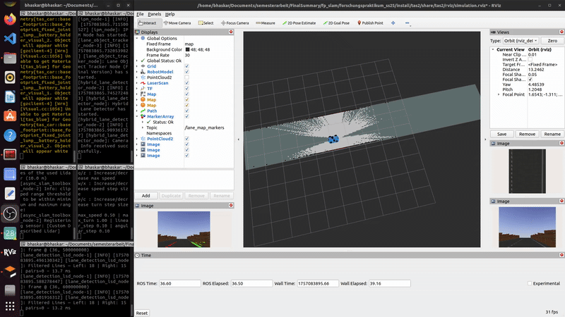

# HybridSLAM_-MultisensorSLAM-Presentation
# Hybrid SLAM with Lane Marking Fusion for the TAS Car

This repository contains the **ROS 2 implementation for a hybrid Simultaneous Localization and Mapping (SLAM) system**, developed as a Practical research. The system enhances a traditional **LiDAR-based SLAM approach** by incorporating **vision-based lane markings**, resulting in a richer and more accurate map for autonomous navigation.

The entire system is developed for the **TAS Car platform** and is designed to run in the **Gazebo simulation environment** using **ROS 2 Humble**.

> [!NOTE]
> **Code Availability & Academic Policy / Hinweis zur Code-Verfügbarkeit**
>
> 🇬🇧 **English:** Due to university intellectual property guidelines and academic policy at TU München, the full implementation codebase is hosted in a private repository. I am very glad to present the code, explain the software architecture, and provide a live walkthrough during an interview or personal technical meeting.
>
> 🇩🇪 **Deutsch:** Aufgrund der Richtlinien zum Schutz des geistigen Eigentums sowie universitärer Vorgaben der TU München (IP- & Vertraulichkeitsrichtlinien) ist der vollständige Quellcode in einem privaten Repository hinterlegt. Sehr gerne präsentiere ich den Code, die Softwarearchitektur sowie eine Live-Demonstration im Rahmen eines persönlichen Gesprächs oder Interviews.

---

## Video Demonstration

[Downlaod Full Video (MP4)](https://gitlab.lrz.de/00000000014B74B0/forschungspraktikum_ss25/-/blob/main/Video_of_slam.mp4?ref_type=heads)

---

## 📝 Overview

The core of this project is a **multi-sensor fusion pipeline** that combines **geometric data from a LiDAR** with **semantic data from an RGB-D camera**.

- **Geometric Mapping**: A standard **LiDAR SLAM pipeline** (`slam_toolbox`) is used to generate a **2D occupancy grid map** of static obstacles (e.g., track walls).
- **Visual Perception**: A custom vision pipeline uses **Inverse Perspective Mapping (IPM)** and **contour analysis** to detect lane markings from the camera feed. These 2D features are projected into 3D using the camera's depth information.
- **Map Fusion**: The 3D lane markings are tracked and rasterized onto the geometric map, creating a single, unified **"hybrid map"** that contains both **physical obstacles and semantic lane information**.

---

## 📦 Packages in this Workspace

This workspace contains several custom ROS 2 packages:

- **`tas2`**: The main package containing the robot description (URDF), launch files, world files, and RViz configurations.
- **`ipm_tools`**: Contains the core vision processing and map fusion nodes (`hybrid_lane_detector`, `lane_object_tracker`, `combined_map_node`).
- **`lane_detection_slam`**: Contains the auxiliary LSD-based lane detection node for visualization.
- **`tf_converter`**: A utility package for converting TF transforms to pose messages for logging.
- **`tas_hardware`**: Contains the Gazebo plugin for `ros2_control`.
- **`urg_node2`**: Used to communicate with LiDAR sensors, the Hokuyo URG series.
- **`ros2_laser_scan_merger`**: Used to combine laser scans from multiple LiDAR sensors into a single data stream.

---

## 📁 Project Packages Structure
```text
└── src/
    ├── tas2/
    ├── ipm_tools/
    ├── lane_detection_slam/
    ├── tf_converter/
    ├── tas_hardware/
    ├── ros2_laser_scan_merger/
    └── urg_node2/
```

---

## 🚀 How to Run the Simulation
1. Build the Workspace
Before running, navigate to the root of your workspace and build the packages:
```bash
colcon build --symlink-install
```

### 2. **Source the Workspace**
In every new terminal you open, you must first source the workspace to make your ROS 2 packages available:
```bash
source install/setup.bash
```

### 3. **Run the Full Hybrid SLAM System***
To run the complete system, you will need to open several terminals. Make sure to source your workspace in each new terminal.
➡️ **Terminal 1: Launch the Gazebo Simulation & SLAM**
This command starts the Gazebo simulator, loads the track world, spawns the TAS Car, and launches the slam_toolbox node for LiDAR-based mapping.
```bash
ros2 launch tas2 simulation.launch.py
```
➡️ **Terminal 2: Launch the `Slam_toolbox`**
This command launches just the `slam_toolbox` node. This can be useful for running SLAM with a recorded dataset (bag file) instead of a live simulation.
```bash
ros2 launch tas2 slam.launch.py
```
➡️ **Terminal 3: Launch the Lane Detection Pipeline**
This command starts the vision-based perception nodes, which detect and process the lane markings from the car's camera.
```bash
ros2 launch tas2 ipm_tools.launch.py
```
➡️ **Terminal 4: Launch LSD-Based Lane Detection**
This command launches the secondary, LSD-based lane detection node for comparison or visualization purposes.
```bash
ros2 launch tas2 lane_detection.launch.py
```
➡️ **Terminal 5: Launch Teleoperation**
To drive the car around the track and build the map, you can use the teleoperation script.
```bash
ros2 run tas2 teleop_accel.py
```

---

## 📈 Saving Maps
### 1. **Saving the Combined Map**
While the simulation is running, you can save the generated hybrid map to a file. Open a new terminal and run:
```bash
ros2 run nav2_map_server map_saver_cli -f my_combined_map
```
This will save the map into `my_combined_map.yaml` and `my_combined_map.pgm`.

### 2. **Recording Data for Evaluation**
To evaluate the performance of the SLAM system, you can record the robot's trajectory into a rosbag file.
➡️ **New Terminal: Record the Rosbag**
While driving the robot, open a new terminal and run:
```bash
ros2 bag record -o evaluation_data /odometry/filtered /tf /tf_static
```
This will create a folder named `evaluation_data` containing the recorded topics. Stop the recording with Ctrl+C when you are done.

---

## 📈 Evaluation
### 1. **Analyzing the Results from the Rosbag**
After recording, you can play back the data and run the analysis scripts to generate evaluation plots.

➡️ **Terminal 1: Play the Rosbag**
First, ensure the live simulation is stopped. Then, in a terminal, play the bag file:
```bash
ros2 bag play evaluation_data
```
➡️ **Terminal 2: Run the Ground Truth Publisher**
While the bag is playing, open a second terminal to publish the ground truth data for comparison.
```bash
ros2 run tas2 ground_truth_publisher.py
```
➡️ **Terminal 3: Run the Analysis Script**
Finally, open a third terminal to run the plotting script. This script listens to the topics from the bag and the ground truth publisher to generate and save the results.
```bash
python3 analysis/plot_validation.py
```
